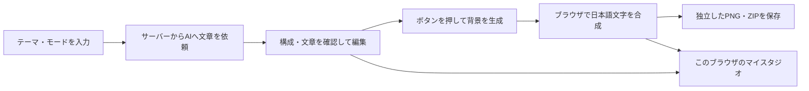

# mellōのしくみと、これからの育て方

2026-10-27、現在の公開版を最初の安定版 **v1.0.0** として確保しました。機能を増やす前にここへ戻れるようにする、最初の基準点です。公開先の内部番号は「バージョン4」ですが、これまでの試作を経て最初の完成版としたため、アプリの安定版名をv1.0.0とします。

## 何が、どこで動いている？

| 場所 | 役割 |
| --- | --- |
| 利用者のブラウザ | 入力・編集画面、日本語文字の配置、PNG・ZIPの作成、マイスタジオの保存 |
| サーバー | 利用パスワードの確認、APIキーの管理、OpenAIへの依頼、回答の形式・内容の点検 |
| OpenAI | 投稿の文章・キャプション・背景イラストの生成、文章や画像の点検 |
| GitHub | アプリの設計図であるソースコードと、その変更履歴の保管 |
| Sites / Cloudflare Workers | 依頼人がアクセスする公開Webアプリを動かす場所 |



AIに完成画像の日本語まで描かせるのではなく、**AIが作った背景に、プログラムが正しい日本語を載せる**作りです。だから文字・字体・色・透明度・位置の変更は、画像生成をやり直さずに反映できます。

物語では先に一つの全文を作ってからページへ分け、人物・時間・場所・行動のつながりを点検します。ノウハウでは紹介する項目数と配置を決めてから文章を作り、実際のやり方や例があるか確認します。エッセイでは文章をページに分け、同じ背景を共有します。

AIへの指示と、通常のプログラムの両方で品質を支えています。文章や人物の見た目を完全に保証する仕組みではなく、最後は投稿前の確認が必要です。

## 「GitHubに保存」と「公開」は別

- **main**：確認済みの安定版を保管する棚。
- **develop**：次の改善を作って試す作業場所。
- **タグ（v1.0.0など）**：その時点の版に付けた、動かさない名前札。
- **公開サイト**：依頼人が実際に使う版。GitHubへpushしただけでは更新されません。

ローカルの開発用アプリは http://127.0.0.1:3000 で確認します。これはこのパソコンで試すためのURLで、公開中の依頼人の画面には影響しません。公開URLとローカルURLのマイスタジオは別の保存場所です。

## これからの開発手順

1. 改善点を一つ、または関連する小さなまとまりで伝えます。「変えてほしくない部分」も分かっていれば添えます。
2. AIは変更対象と影響範囲を整理し、developで実装します。main上で直接開発せず、依頼にない画面や機能をついでに作り替えません。
3. 変更に応じたテスト・型チェック・ビルドを行い、ローカルの確認URLと、試してほしい操作を提示します。自動テストで分かることと、人の目で確認することを区別します。
4. あなたが確認版を試します。気になるところがあれば、その版で修正を続けます。
5. **「この確認版を公開して」など、公開することが分かるOKをもらった後だけ**、確認した変更をmainへ取り込み、公開サイトを更新します。単なる修正依頼や「試したい」は公開許可として扱いません。
6. 更新前の版を記録し、新しい安定版にタグを付け、公開先の保存バージョンと対応付けます。公開後に接続や必要な操作を確認します。

承認後にアプリの振る舞いを変える追加修正が必要になった場合は、追加分を確認してもらってから公開します。公開用ランタイムへの移植・ビルドの差分も確認対象です。

今回は「今の版をmainに保存する」という依頼に基づき、管理用の資料とルールをmainへ追加しています。公開サイトは更新していません。

## 壊れたら、どこまで戻せる？

| 戻したいもの | 戻し方 |
| --- | --- |
| 開発途中の変更 | Gitの変更履歴から対象の修正を取り消す。ほかの編集を巻き込む一括リセットはしない |
| GitHubのプログラム | タグやコミットを基準に、取り消し用の変更を作って確認する。mainの履歴や安定版タグを強制的に書き換えない |
| 公開サイト | 記録したSitesの保存済みバージョンを指定して再公開する。あなたからの復元指示がある場合だけ実行する |

v1.0.0の対応表は [releases/v1.0.0.json](releases/v1.0.0.json) に残しています。これにより「GitHubのどのコード」と「公開先のどの完成済みデータ」が対応するか追跡できます。

**プログラムを戻すことと、投稿データを戻すことは別です。** マイスタジオの画像・下書きは利用者のブラウザ内にあり、GitHubには保存されません。GitHubのタグでは、消した投稿やブラウザデータは復元できません。PNG・ZIPは投稿用の出力で、編集可能な下書き全体のバックアップではありません。今後保存形式を変更する場合は、旧データを読めることと、復元先の版での互換性を確認します。

APIキーや利用パスワードもGitの復元対象ではありません。公開先の秘密設定として別に保持します。また、同じコードへ戻してもAIの生成結果が毎回同じになるわけではありません。

## 今の基準として残す機能

- 短い物語・思いを綴る・情報を伝える、の3モード。
- 新規投稿は4:5、ほかに1:1と9:16。各スライドを独立したPNGとして出力。
- 登場する大人の見た目は30代が初期値。読者ターゲットとは別に指定。
- 文章を先に確認し、明示的なボタン操作で画像を生成。文字の編集だけでは画像APIを呼ばない。
- 字体・色・文字背景の透明度、全ページへの文字設定適用。物語・エッセイでは文字位置の移動も可能。
- マイスタジオへの保存・再開、既存データとの互換性、個別PNG・ZIP・キャプション保存。
- APIキーをブラウザやGitHubへ公開しない。

これらは今後一切変更できないという意味ではありません。**依頼に含まれない部分を、黙って変えない**ための基準です。

## 開発者向け：主なファイル

| ファイル | 担当 |
| --- | --- |
| `components/Studio.tsx` | 入力、生成の進行、編集、ダウンロードの操作 |
| `components/PasswordGate.tsx` | 利用パスワードの入口 |
| `components/AppearanceControls.tsx` / `ReadingPosition.tsx` | 字体・色・透明度、文字位置の操作 |
| `lib/server/prompts.ts` / `stories.ts` | AIへの文章指示、物語の全文生成・分割・点検 |
| `app/api/plan` / `review` / `image` | 文章生成・校正・画像生成の窓口 |
| `lib/schema.ts` / `composition.ts` | 入出力形式、文字数・項目数・枚数などの検証 |
| `lib/render.ts` / `templates.ts` / `formats.ts` | 日本語の画像合成、デザイン、寸法 |
| `lib/projects.ts` / `use-projects.ts` | ブラウザ内の下書き・画像の保存と復元 |
| `.github/workflows/ci.yml` | GitHub上でのテスト・型チェック・ビルド。公開処理は含まない |

GitHub版はNext.js。公開版は同じUI・生成ロジックをSitesのVinext互換ランタイムで動かしています。現状、GitHubから公開版への自動同期はありません。公開用ソースを更新するときは差分を確認し、公開環境に必要な処理・秘密設定を保持します。

## 開発者向け：Git操作の基本

```sh
# 新しい改善を始める
 git switch develop
 git pull --ff-only origin develop

# 変更を確認・保存し、開発用ブランチだけ共有する
 git diff
 git add <今回変更したファイル>
 git commit -m "変更内容"
 git push origin develop
```

mainへの取り込みは、確認版を試してもらい、対象変更への承認がある場合だけ行います。公開はさらに明示的な公開OKが必要です。GitHubのPull Requestに変更内容・検証結果・触っていない範囲を残す運用を基本にします。承認済み変更をmainへ取り込んだ後は、developにも反映し、次回はその確認済み状態から始めます。

過去版を調べるだけなら、安定版タグから別の確認用ブランチを作ります。mainや公開版を自動的には動かしません。

```sh
 git switch -c inspect/v1.0.0 v1.0.0
```

この運用は、ブランチ・資料・AIへの指示によるものです。GitHub管理画面の「mainへの直接pushを禁止する」強制保護は、この作業では設定していません。将来CI・承認の強制が必要になれば、利用プランと管理権限を確認して別途設定します。
